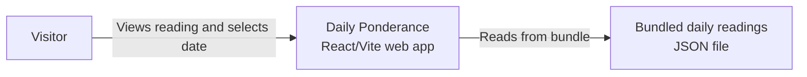
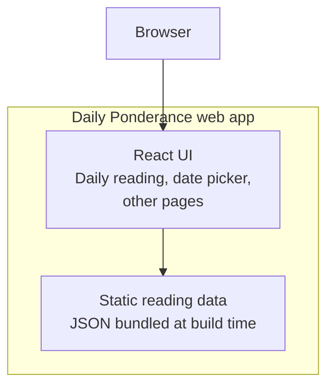
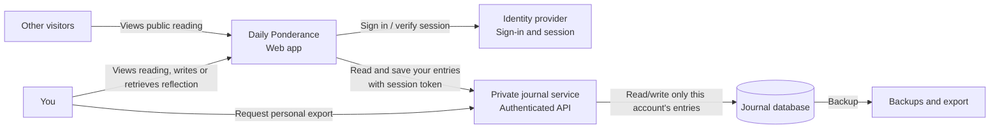
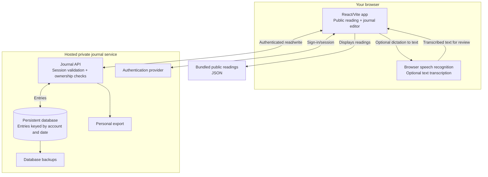

# Daily Ponderance: Public Reading, Private Journal

This document describes the current app and a proposed architecture for adding a private journal. The diagrams use Mermaid and render inline in compatible Markdown viewers, including GitHub.

## As-is: current system

The app is a static React/Vite frontend. Daily readings are bundled with the frontend as JSON. There is no server, sign-in, or persistent private journal today.

### C4 · System context

### C4 · Container view

## To-be: private journal added

The reading remains public. Personal reflections live behind an authenticated hosted service, separate from the public reading bundle.

### C4 · System context

### C4 · Container view

## Private data flow

1. You open a reading and select a date.
2. After sign-in, the app checks whether you have a reflection saved for that date.
3. You type or dictate text. Dictation fills the editor for review; the first version does not save audio.
4. On save, the app sends the date and reflection to the journal API using your authenticated session.
5. The API derives your account from the session and checks ownership before reading or writing. The browser cannot choose which account's entries it accesses.
6. The journal view retrieves your entries by date. You can request an export of your entries.

## Implemented first version

- Supabase Auth handles email/password sign-up and sign-in. The browser uses the project URL and publishable/anon key; no service-role key is used in the client.
- Supabase Postgres stores one reflection per authenticated user per date. Row-level security policies restrict select, insert, update, and delete to `auth.uid()`.
- The React client uses a `JournalRepository` interface so the storage adapter can be replaced later without coupling the editor to Supabase query details.
- The daily reading page includes a private reflection editor. `/journal` lists entries and provides JSON export and deletion.
- The SQL setup is in `supabase/migrations/202611160001_create_journal_entries.sql`; local environment setup is documented in `README.md`.

Supabase Free currently has no monthly charge within its limits, but free projects may pause after inactivity and do not include automatic backups. Users should export entries periodically if they need an independent copy. AWS migration remains a future option.

## Decisions

- Daily readings remain public and locally bundled.
- Journal access requires a Supabase account and hosted private service, allowing access across devices.
- The initial model is one editable reflection per date.
- Voice input transcribes to text; audio recording and storage are out of scope.
- Supabase Free project inactivity, backup, and recovery limits apply; plan an upgrade or separate backup approach before treating the journal as the sole copy of important writing.
